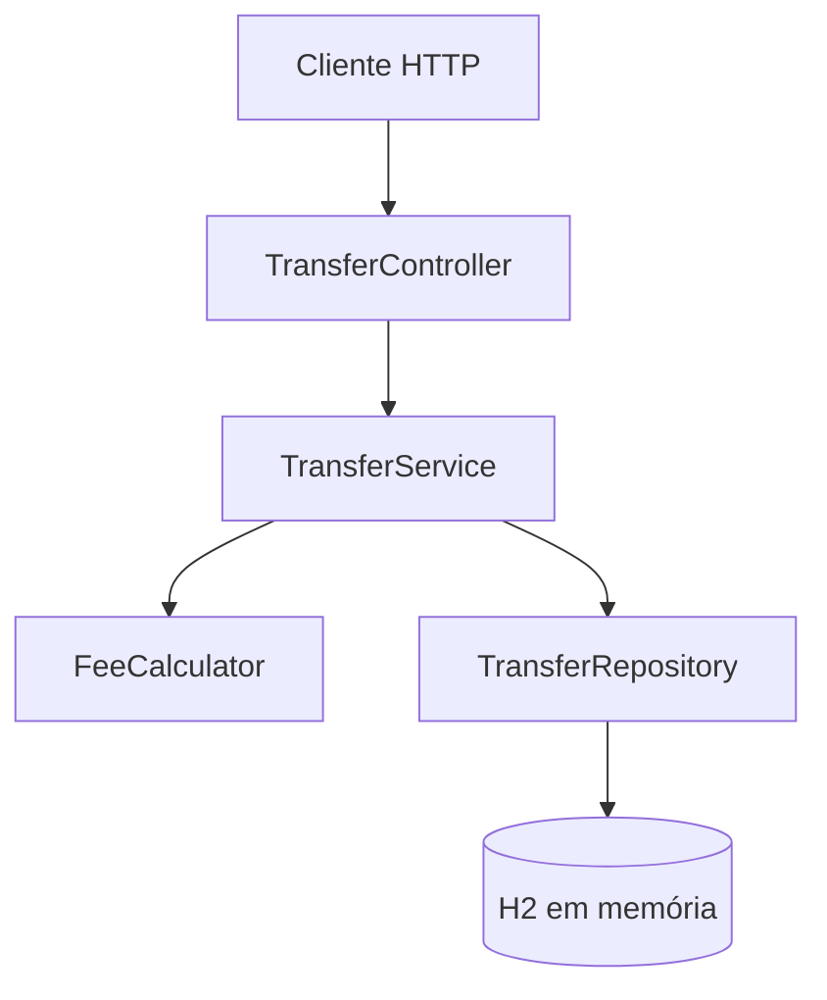

<div align="center">

# 💸 Schedule Transfer

### API REST para agendamento de transferências financeiras

Construído com Java 11, Spring Boot 2.7, Spring Data JPA e H2.


</div>

## Sobre

Projeto de estudo de uma API REST que registra agendamentos de transferências, calcula uma taxa provisória conforme o prazo e apresenta o valor total (valor transferido + taxa). **Não movimenta dinheiro real** e não substitui um sistema bancário seguro.

## Tecnologias

- Java 11
- Spring Boot 2.7.18
- Spring Web
- Spring Data JPA
- Bean Validation
- H2 em memória
- Maven
- JUnit 5 e Mockito

## Tabela provisória de taxas

A tabela abaixo foi usada como regra inicial de exemplo e deve ser confirmada antes de tratar a regra como definitiva.

| Prazo entre criação e agendamento | Taxa |
|---|---:|
| Mesmo dia (D+0) | 2,5% do valor |
| De 1 a 10 dias | R$ 12,00 fixos |
| De 11 a 20 dias | 8,2% do valor |
| De 21 a 30 dias | 6,9% do valor |
| De 31 a 40 dias | 4,7% do valor |
| De 41 a 50 dias | 1,7% do valor |

A taxa é cobrada **além** do valor transferido. O prazo máximo é de 50 dias. Agendamentos no passado ou além desse limite são rejeitados. Os percentuais são arredondados para duas casas decimais.

## Arquitetura



- **Controller:** endpoints HTTP.
- **Service:** regras de negócio e cálculo do total.
- **FeeCalculator:** cálculo de taxas.
- **Repository:** persistência com Spring Data JPA.
- **Entity/DTO:** modelo persistido e contrato de entrada/saída.
- **ApiExceptionHandler:** respostas padronizadas para erros.

## Endpoints

| Método | Rota | Descrição |
|---|---|---|
| `POST` | `/api/transfers` | Criar agendamento |
| `GET` | `/api/transfers` | Listar agendamentos |
| `GET` | `/api/transfers/{id}` | Consultar um agendamento |
| `PATCH` | `/api/transfers/{id}/cancel` | Cancelar um agendamento |

### Exemplo de criação

`POST /api/transfers`

```json
{
  "sourceAccount": "12345-0",
  "destinationAccount": "98765-4",
  "amount": 250.00,
  "scheduledDate": "2026-10-20"
}
```

A data do exemplo é ilustrativa; informe uma data entre hoje e os próximos 50 dias. A resposta inclui `amount`, `fee` e `totalAmount`.

## Como executar

Requisitos: JDK 11 e Maven (ou Maven Wrapper, se incluído).

```bash
git clone URL_DO_SEU_REPOSITORIO
cd schedule-transfer
mvn spring-boot:run
```

A API inicia em `http://localhost:8080`.

Console H2: `http://localhost:8080/h2-console`

- JDBC URL: `jdbc:h2:mem:scheduletransfer`
- User: `sa`
- Password: em branco

O banco é em memória; os dados são perdidos quando a aplicação é encerrada.

## Testes

Execute:

```bash
mvn test
```

Os testes unitários cobrem as faixas de taxa, limites de prazo, rejeição de datas passadas, soma da taxa ao valor e rejeição de contas de origem/destino iguais.

## Validações implementadas

- Contas de origem e destino obrigatórias, com até 120 caracteres.
- Valor obrigatório e maior que zero.
- Data de agendamento obrigatória.
- Data entre hoje e 50 dias.
- Conta de origem diferente da conta de destino.
- Tratamento de registro não encontrado.
- Não permite cancelar uma transferência já cancelada.

## Próximos passos

- Confirmar formalmente a tabela de taxas.
- Adicionar testes de integração dos endpoints.
- Definir política de autenticação/autorização.
- Avaliar persistência durável e requisitos de segurança antes de qualquer uso real.

## Autor

André Luiz Lopes de Oliveira — estudante de Engenharia de Software.

> Este projeto é didático. Não integra instituições financeiras, não realiza liquidação e não deve receber dados bancários reais.
